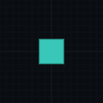

# Playground invisible-world repair (2026-11-12 UTC)

The latest user session, 2026-11-11 22:09:31–22:10:07 CST, recorded accepted grain additions, erases and blocked placements while the user saw no objects. There were no physics submissions or solver faults. Those facts proved model edits, not visibility. The embedded identity matched the November 8 repair even though Finder retained an earlier bundle date.

`CoupledPlaygroundView` submitted the full-screen grid, bodies and previews with one shader whose queue was Transparent. Each draw had the same bounds, with `ZTest Always` and no depth writes. Equal-queue transparent sorting could place the opaque-alpha grid over the body draw. Submission order did not protect the world from being covered.

A camera render/readback regression reproduced the reported result through the actual project render pipeline: **0/2 passed** on the original renderer (`/private/tmp/debris-render-baseline.xml`). Both accepted live GPU state and the frozen edit snapshot rendered only the grid; the expected body sample was background RGBA(0.035, 0.051, 0.071, 1).

The view now sets explicit material queues: Background for the grid, Geometry for bodies and Transparent for tool overlays. No shader equations, physics, commands, pause behavior or GPU buffer counts changed. The same two pixel checks now pass. Combined with existing pause/logging regressions, **11/11 passed**, `/private/tmp/debris-render-fixed.xml`, 2026-11-12 04:12:14Z, duration 0.2925196 seconds. No scale or solver checks were repeated for this rendering-only change; November 8's 39-check evidence remains applicable to unchanged simulation.

The camera test exercises actual rendering without launching the standalone app. Final build identity and completion are recorded below. Actual on-screen player interaction remains a manual acceptance check; no automatic player launch.

Final Mac build succeeded with exit 0 and no C#/shader errors (`/private/tmp/debris-render-build.log`); all manifest source hashes match. Source identity `722df31422bfecb3324c33ecf29fcf621e6a80ec811eda89516f02ddf6dd539a`. Reopen `Builds/PhysicsPlayground/Debris Physics Playground.app`, outside the Burst debug folder. No standalone player was launched.
